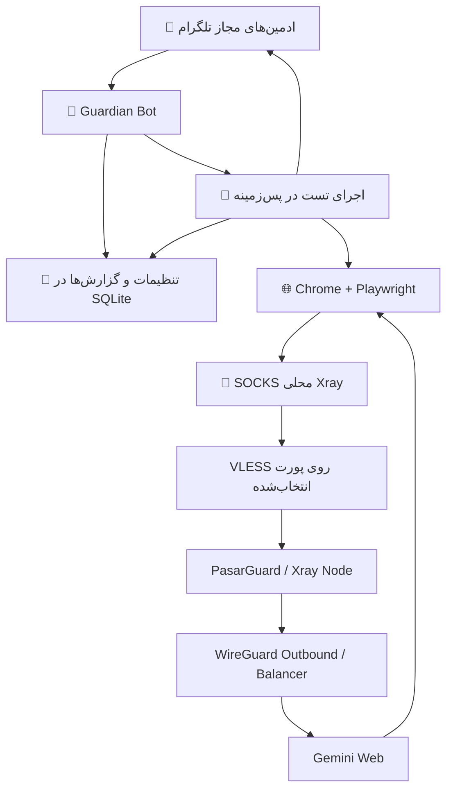

# 🛡️ Xray Gemini Guardian

### مانیتورینگ واقعی Gemini Web از پشت خروجی‌های Xray، با ربات تلگرام و Docker

[](https://github.com/h-zare-dev/xray-gemini-guardian/actions/workflows/tests.yml)


**Xray Gemini Guardian** یک ربات تلگرام خصوصی است که بررسی می‌کند آیا سایت **Gemini واقعاً از مسیر هر خروجی VLESS/Xray پاسخ می‌دهد یا نه**. به‌جای تکیه بر Ping، GeoIP یا بازشدن ظاهری سایت، یک مرورگر واقعی Chrome را از پروکسی هر پورت عبور می‌دهد، پیام آزمایشی ارسال می‌کند، پاسخ دستیار را بررسی می‌کند و نتیجه را همراه با اسکرین‌شات و گزارش ذخیره می‌کند.

این پروژه نسخهٔ سروری [Xray Gemini Browser Audit](https://github.com/h-zare-dev/xray-gemini-browser-audit) است؛ الگوریتم اصلی تأیید ارسال پیام و بررسی پاسخ واقعی از آن پروژه حفظ شده است.

> [!IMPORTANT]
> این ابزار **فقط پایش و گزارش** انجام می‌دهد. در نسخه فعلی، IPهای WireGuard را عوض نمی‌کند، خروجی‌های Xray روی PasarGuard را تغییر نمی‌دهد و هیچ دستوری برای دستکاری بالانسر تولیدی نمی‌فرستد. اتصال `WEB_OK` در Gemini **Web** هم به معنی تضمین کارکرد اپ اندروید یا تمام سرویس‌های Google نیست.

**راهنمای این صفحه از صفر نوشته شده است.** اگر از قبل Docker و ربات را نصب کرده‌اید، از بخش [راه‌اندازی اولیه در تلگرام](#first-run) ادامه دهید.

## 📚 فهرست مطالب

- [ویژگی‌ها](#features)
- [معماری و نحوه کار](#architecture)
- [پیش‌نیازها](#requirements)
- [نصب Docker روی Ubuntu](#install-docker)
- [ساخت ربات تلگرام و دریافت آیدی](#telegram-setup)
- [چند ادمین با دسترسی کامل](#multi-admin)
- [دریافت پروژه و راه‌اندازی](#deployment)
- [راه‌اندازی اولیه در تلگرام](#first-run)
- [ورود Google با noVNC و SSH Tunnel](#google-login)
- [مدیریت پورت‌ها و منابع](#sources-and-ports)
- [اجرای تست یک پورت و همه پورت‌ها](#run-tests)
- [نتایج، گزارش‌ها و اسکرین‌شات‌ها](#reports)
- [تنظیمات و زمان‌بندی](#settings)
- [نگهداری، آپدیت و بکاپ](#operations)
- [عیب‌یابی](#troubleshooting)
- [امنیت و محدودیت‌ها](#security)
- [توسعه و تست](#development)
- [سؤالات متداول](#faq)

<a id="features"></a>

## ✨ ویژگی‌ها

| قابلیت | توضیح |
|---|---|
| 🤖 ربات تلگرام فارسی | منوهای دکمه‌ای، آیکون، وضعیت لحظه‌ای، شروع/توقف و تنظیمات |
| 🔒 چند ادمین هم‌سطح | تا ۲۰ آیدی عددی مجاز، همگی با دسترسی کامل و فقط در چت خصوصی |
| 🔌 مدیریت پورت | افزودن تکی/رنج، جایگزینی لیست، فعال/غیرفعال‌کردن، حذف و تست تک‌پورت |
| 🔗 مدیریت منابع | یک لینک VLESS با چند پورت یا چند URL سابسکریپشن VLESS |
| 🌐 Chrome واقعی | اجرای مرورگر گرافیکی داخل Docker بدون نصب محیط دسکتاپ روی سرور |
| 🔐 نشست Google پایدار | ورود دستی از طریق noVNC؛ ذخیره نشست در Docker volume |
| 🧪 تشخیص پاسخ واقعی | تأیید ارسال پیام، شناسایی پاسخ `model-response` و پایداری متن |
| 📸 گزارش تصویری | عکس هر تلاش، ارسال اختیاری به تلگرام، CSV و تاریخچه اجراها |
| 📬 گزارش لحظه‌ای هر پورت | موفقیت یا خطای **هر پورت** بلافاصله پس از پایان همان تست اطلاع داده می‌شود |
| 🛑 تشخیص خطای حساب | جداسازی محدودیت Google/ورود مجدد از مسدودبودن منطقه یا خرابی شبکه |
| ⏱ زمان‌بندی اختیاری | اجرای دوره‌ای قابل فعال‌سازی از ربات؛ پیش‌فرض خاموش |
| 🐳 Docker-only | Xray، Chrome، Playwright، Xvfb، noVNC و ربات در یک image |

<a id="architecture"></a>

## 🧭 معماری و نحوه کار



برنامه روی سرور **یک اتصال در هر لحظه** را بررسی می‌کند. وقتی یک پورت تمام شد، Chrome و Xray آن تست بسته می‌شوند و پورت بعدی با اتصال تازه آزمایش می‌شود. این کار احتمال باقی‌ماندن اتصال‌های قبلی Chrome روی IP قدیمی را کاهش می‌دهد.

- دسترسی به API پنل PasarGuard یا Docker socket میزبان **لازم نیست**.
- ربات به Xray نصب‌شده روی نود دسترسی مدیریتی نمی‌خواهد؛ فقط مانند یک **کلاینت VLESS واقعی** به آن متصل می‌شود.
- تست‌ها برای بررسی کیفیت پاسخ Gemini هستند؛ ابزار تست سرعت، ظرفیت گیگابیتی یا load balancing نیستند.

<a id="requirements"></a>

## 🧰 پیش‌نیازها

| مورد | وضعیت |
|---|---|
| سرور Linux (مثلاً Ubuntu 24.04/26.04) | لازم |
| Docker Engine و Docker Compose V2 | لازم |
| SSH به سرور | لازم برای ورود گرافیکی امن |
| ربات تلگرام و توکن BotFather | لازم |
| آیدی عددی اکانت‌های تلگرام ادمین‌ها | لازم |
| یک لینک VLESS فعال یا سابسکریپشن مناسب | لازم برای تست |
| خروجی اینترنت سرور به Telegram و Google | لازم |
| RAM حدود ۴ GB یا بیشتر | پیشنهاد عملی برای اجرای Chrome |
| نصب Python / Chrome / Xray روی میزبان | **لازم نیست** |

اولین build اینترنت و فضای دیسک کافی برای دریافت imageها و Chrome می‌خواهد. حجم و زمان ساخت بسته به شبکه و سرور متفاوت است.

<a id="install-docker"></a>

## 1. نصب Docker روی Ubuntu

اگر دستورهای زیر از قبل درست اجرا می‌شوند، از این بخش عبور کنید:

```bash
docker --version
docker compose version
```

برای سرور تازه، روش رسمی نصب با مخزن Docker روی Ubuntu:

```bash
sudo apt update
sudo apt install -y ca-certificates curl git
sudo install -m 0755 -d /etc/apt/keyrings
sudo curl -fsSL https://download.docker.com/linux/ubuntu/gpg -o /etc/apt/keyrings/docker.asc
sudo chmod a+r /etc/apt/keyrings/docker.asc
```

سپس مخزن رسمی Docker را اضافه کنید:

```bash
sudo tee /etc/apt/sources.list.d/docker.sources > /dev/null <<EOF
Types: deb
URIs: https://download.docker.com/linux/ubuntu
Suites: $(. /etc/os-release && echo "${UBUNTU_CODENAME:-$VERSION_CODENAME}")
Components: stable
Architectures: $(dpkg --print-architecture)
Signed-By: /etc/apt/keyrings/docker.asc
EOF
```

و نصب را کامل کنید:

```bash
sudo apt update
sudo apt install -y docker-ce docker-ce-cli containerd.io docker-buildx-plugin docker-compose-plugin
sudo systemctl enable --now docker
sudo docker run --rm hello-world
docker compose version
```

اگر Docker قبلاً از روش دیگری نصب شده، **بدون بررسی بسته‌های موجود آن را دوباره نصب یا حذف نکنید**. برای نسخه‌های پشتیبانی‌شده و رفع تداخل پکیج‌ها، [راهنمای رسمی Docker روی Ubuntu](https://docs.docker.com/engine/install/ubuntu/) مرجع است.

> دستورهای بعدی با فرض دسترسی کاربر فعلی به Docker نوشته شده‌اند. اگر کاربر شما اجازه اجرای Docker ندارد، از `sudo docker compose` استفاده کنید. دسترسی گروه `docker` عملاً سطح دسترسی بالایی به میزبان می‌دهد.

<a id="telegram-setup"></a>

## 2. ساخت ربات تلگرام و دریافت Admin ID

1. در تلگرام، ربات رسمی [@BotFather](https://t.me/BotFather) را باز کنید.
2. دستور `/newbot` را ارسال کنید.
3. یک نام دلخواه مانند `Xray Gemini Guardian` انتخاب کنید.
4. یک username یکتا که به `bot` ختم می‌شود انتخاب کنید.
5. **توکن ربات** را دریافت و در جای امن نگهداری کنید.
6. وارد چت ربات تازه‌ساخته‌شده شوید و `/start` بزنید.

برای یافتن شناسه عددی اکانت خودتان، می‌توانید از ابزارهای نمایش ID استفاده کنید. روش مستقیم‌تر با API رسمی Telegram (بعد از ارسال `/start` به ربات و پیش از راه‌اندازی polling برنامه)، بدون واردکردن توکن در دستور ثبت‌شده در shell history:

```bash
read -r -s -p "BotFather token: " GUARDIAN_TMP_TOKEN
printf '\n'
curl -fsS "https://api.telegram.org/bot${GUARDIAN_TMP_TOKEN}/getUpdates"
unset GUARDIAN_TMP_TOKEN
```

در خروجی JSON به مقدار `message.from.id` پیام خودتان نگاه کنید؛ همین شناسه عددی را در `TELEGRAM_ADMIN_IDS` قرار دهید. برای ادمین دوم هم شناسه اکانت خودش را بگیرید. **توکن واقعی را در تاریخچه shell، اسکرین‌شات، issue یا چت عمومی منتشر نکنید.** توجه کنید هنگام درخواست API، توکن به‌طور موقت در آرگومان فرایند curl وجود دارد؛ این کار را فقط در محیط مورداعتماد خودتان انجام دهید.

راهنمای رسمی: [Telegram BotFather](https://core.telegram.org/bots/tutorial).

<a id="multi-admin"></a>

### 👥 چند ادمین با دسترسی کامل

از نسخه **0.1.2** همه ادمین‌های مجاز **دسترسی کاملاً یکسان** دارند؛ نقش Owner/Viewer یا سطح دسترسی جداگانه تعریف نشده است. آیدی‌ها را با کاما از هم جدا کنید:

```dotenv
TELEGRAM_BOT_TOKEN=YOUR_BOTFATHER_TOKEN
TELEGRAM_ADMIN_IDS=123456789,987654321,555444333
```

- تا **۲۰ ادمین** پذیرفته می‌شود و آیدی‌های تکراری خودکار حذف می‌شوند. فقط **شناسه عددی User** معتبر است، نه username یا شناسه گروه.
- هر ادمین باید حداقل یک بار در **چت خصوصی ربات** `/start` بزند؛ قبل از آن تلگرام اجازه ارسال گزارش و پیام شروع به ربات نمی‌دهد. کاربری که `/start` نزده مانع گزارش سایر مدیرها نمی‌شود.
- نتیجهٔ **هر پورت**، گزارش نهایی، پیام‌های توقف/خطا و اسکرین‌شات‌های فعال‌شده، **به تمام ادمین‌ها** ارسال می‌شوند. تمام ادمین‌ها می‌توانند از منو گزارش‌های ذخیره‌شده را ببینند.
- تنظیمات، لیست پورت‌ها، نشست Google و اجرای تست **مشترک** است. در هر لحظه فقط یک اجرای تست مجاز است؛ هر ادمین می‌تواند تست جاری را متوقف کند. اطلاعات در حال واردکردن داخل منوی تلگرام برای هر ادمین به‌صورت جداگانه نگهداری می‌شود.
- برای جلوگیری از افشای لینک‌های حساس و عکس‌ها، آیدی فردی را فقط وقتی اضافه کنید که به او اعتماد کامل دارید؛ **هیچ بخشی از ربات در گروه اجرا نمی‌شود**.
- متغیر قدیمی `TELEGRAM_ADMIN_ID=123456789` برای نصب‌های تک‌ادمین همچنان پشتیبانی می‌شود. اگر **هر دو** متغیر در `.env` باشند، `TELEGRAM_ADMIN_IDS` اولویت دارد.

برای اضافه/حذف کردن مدیر بعد از نصب، `.env` را ویرایش کنید و **پس از اتمام تست جاری** اجرا کنید:

```bash
docker compose up -d --force-recreate guardian
```

این کار متغیر محیطی تازه را به کانتینر می‌دهد؛ `docker compose restart` به‌تنهایی تغییر `.env` را اعمال نمی‌کند. داده‌ها و پروفایل Google داخل volume باقی می‌مانند.

<a id="deployment"></a>

## 3. دانلود و اجرای پروژه

روی سروری که Docker دارد:

```bash
git clone https://github.com/h-zare-dev/xray-gemini-guardian.git
cd xray-gemini-guardian
```

فایل تنظیمات اولیه را بسازید:

```bash
cp .env.example .env
chmod 600 .env
nano .env
```

فقط **توکن و لیست ادمین‌ها** لازم‌اند:

```dotenv
TELEGRAM_BOT_TOKEN=YOUR_BOTFATHER_TOKEN
TELEGRAM_ADMIN_IDS=YOUR_NUMERIC_USER_ID,SECOND_ADMIN_NUMERIC_ID
```

لینک VLESS، لیست پورت‌ها، سابسکریپشن، تنظیمات تست و زمان‌بندی را داخل **ربات تلگرام** تعیین می‌کنید؛ نیازی نیست آن‌ها را در `.env` وارد کنید.

تنظیمات Compose را بررسی و برنامه را بالا بیاورید:

```bash
docker compose config --quiet
docker compose up -d --build
docker compose ps
docker compose logs --tail=100 guardian
```

✅ در صورت اجرای درست، کانتینری با نام `xray-gemini-guardian` بالا می‌آید. **هر ادمین** وارد چت خصوصی ربات شود و `/start` بزند. تمام تنظیمات و نشست Google در Volume نگهداری می‌شوند؛ با ری‌استارت معمولی کانتینر پاک نمی‌شوند.

**دستورات روزمره:**

```bash
docker compose ps                     # وضعیت کانتینر
docker compose logs -f --tail=100 guardian  # مشاهده لاگ زنده
docker compose restart guardian      # راه‌اندازی مجدد (خارج از زمان تست)
docker compose stop guardian         # توقف
docker compose start guardian        # شروع مجدد
```

> [!WARNING]
> اگر تست همه پورت‌ها در حال اجراست، وسط کار `restart` یا `up -d --build` نزنید؛ اجرای در حال انجام قطع می‌شود. برای تغییر تنظیمات معمولاً **نیازی به ری‌استارت** نیست.

<a id="first-run"></a>

## 4. راه‌اندازی اولیه در تلگرام

از چت خصوصی ربات دستور `/start` بفرستید. صفحه اصلی شامل این گزینه‌هاست:

| دکمه در ربات | کاربرد |
|---|---|
| 🚀 تست همه خروجی‌ها | شروع تست ترتیبی همه خروجی‌های فعال |
| ⏹ توقف | درخواست توقف پس از پایان تلاش جاری |
| 🔌 مدیریت پورت‌ها | افزودن، حذف، روشن/خاموش و تست یک پورت |
| 🔗 منابع و سابسکریپشن | انتخاب نوع منبع و ثبت VLESS/اشتراک |
| ⚙️ تنظیمات تست | تنظیم timeout، retry، اسکرین‌شات، زمان‌بندی و غیره |
| 📊 گزارش‌ها و تصاویر | نتایج آخرین تست، CSV، عکس‌ها و تاریخچه |
| 🔐 ورود به Google | بازکردن/بستن Chrome برای ورود دستی |
| 📡 وضعیت سیستم | تعداد خروجی‌ها، وضعیت اجرای تست و نشست مرورگر |

**ترتیب پیشنهادی اولین استفاده:**

1. از بخش **منابع** حالت `VLESS` را انتخاب کنید.
2. لینک معتبر VLESS را ثبت کنید.
3. از بخش **مدیریت پورت‌ها** ابتدا **یک پورت** وارد کنید.
4. با noVNC به Google وارد شوید و نشست را ذخیره کنید.
5. یک تست تک‌پورت بگیرید؛ اگر `WEB_OK` بود، پورت‌های دیگر را اضافه کنید.
6. **تست همه خروجی‌ها** را اجرا کنید و گزارش را ببینید.

برای لغو فرایند دریافت مقدار جدید از ربات، `/cancel` را ارسال کنید.

<a id="google-login"></a>

## 5. ورود Google با مرورگر گرافیکی داخل Docker

سرور به محیط دسکتاپ نیاز ندارد: `Xvfb` یک نمایشگر مجازی می‌سازد، `Chrome` روی آن اجرا می‌شود و `noVNC` تصویر مرورگر را با اتصال SSH به لپ‌تاپ شما منتقل می‌کند.

### 5.1. ایجاد SSH Tunnel روی لپ‌تاپ

در ترمینال **لپ‌تاپ خودتان**، نه سرور:

```bash
ssh -L 6080:127.0.0.1:6080 USER@SERVER_IP
```

- `USER`: نام کاربر SSH سرور (مثلاً `root`).
- `SERVER_IP`: IP عمومی یا دامنه سرور خودتان.
- اگر با کلید خصوصی وصل می‌شوید: `ssh -i /path/to/key -L 6080:127.0.0.1:6080 USER@SERVER_IP`.
- این ترمینال SSH را **باز نگه دارید**.

در مرورگر **لپ‌تاپ** این آدرس را باز کنید:

**[http://127.0.0.1:6080/vnc.html](http://127.0.0.1:6080/vnc.html)**

اگر در `http://127.0.0.1:6080/` فقط `Directory listing for /` دیدید، طبیعی است؛ مستقیم `vnc.html` را باز کنید و روی **Connect** بزنید.

### 5.2. بازکردن Chrome و ورود

1. در ربات تلگرام: **🔐 ورود به Google → 🟢 بازکردن مرورگر**.
2. در noVNC پنجره Chrome ظاهر می‌شود.
3. به `https://gemini.google.com/app` بروید.
4. **خودتان** به حساب Google وارد شوید؛ رمز، کد دومرحله‌ای یا کوکی را به ربات ارسال نکنید.
5. بهتر است یک پیام ساده ارسال کنید و مطمئن شوید Gemini در اتصال مستقیم سرور **واقعاً جواب می‌دهد**.
6. در تلگرام: **🔴 بستن و ذخیره نشست** را بزنید.
7. بسته‌شدن Chrome در noVNC طبیعی است؛ نشست در `/data/chrome-profile` نگهداری می‌شود.

این ورود **بدون پروکسی VLESS** انجام می‌شود؛ آزمایش‌های بعدی Chrome را با پروکسی هر خروجی به‌صورت جداگانه اجرا می‌کنند.

> [!CAUTION]
> noVNC در این نسخه رمز عبور جداگانه ندارد، اما Compose پورت `6080` را فقط روی `127.0.0.1` میزبان منتشر می‌کند. **این bind را به `0.0.0.0` تغییر ندهید.** برای دسترسی از بیرون همیشه SSH Tunnel استفاده کنید. Chrome ممکن است هشدار `--no-sandbox` نشان دهد؛ این پرچم به‌دلیل محیط کانتینری به کار رفته و سطح امنیت مرورگر را کاهش می‌دهد؛ دسترسی به کانتینر و noVNC باید محدود بماند.

<a id="sources-and-ports"></a>

## 6. مدیریت منابع و پورت‌ها

دو حالت مستقل وجود دارد:

### حالت VLESS: یک لینک، چند پورت

در **🔗 منابع و سابسکریپشن** حالت `VLESS` را انتخاب و با «🔑 تنظیم لینک VLESS» لینک کامل خود را ارسال کنید. سپس از **🔌 مدیریت پورت‌ها** رنج را وارد کنید:

```text
21001-21007,22001-22008,23001,23003,24001-24004
```

Guardian برای هر پورت از **همان مقصد و UUID لینک VLESS** استفاده می‌کند، اما شماره پورت مقصد را با پورت انتخاب‌شده جایگزین می‌کند. این حالت زمانی مناسب است که چند inbound روی یک Xray/PasarGuard node تعریف کرده‌اید و هر inbound به outbound یا balancer خاصی می‌رود.

در مدیریت پورت می‌توانید:

- **➕ افزودن پورت/رنج**: فقط شماره‌های جدید اضافه شوند.
- **✏️ جایگزینی لیست**: لیست فعلی کاملاً با ورودی جدید جایگزین شود.
- **🟢/⚪ شماره پورت**: با لمس شماره، فعال یا غیرفعال شود.
- **🗑**: همان پورت حذف شود.
- **🧪 تست یک پورت**: یک پورت فعال را بدون اجرای همه پورت‌ها آزمایش کنید.

برای نسخه اولیه، ابتدا با یک پورت مطمئن شوید لینک واقعاً در ابزار پشتیبانی می‌شود.

### حالت Subscription: هر لینک یک مقصد

در **🔗 منابع و سابسکریپشن**:

1. حالت `Subscription` را انتخاب کنید.
2. روی **➕ سابسکریپشن** بزنید و URL را ارسال کنید.
3. روی **🔄 به‌روزرسانی منابع** بزنید.
4. از **📃 فهرست لینک‌ها** تعداد نودهای خوانده‌شده را ببینید.
5. تست را شروع کنید؛ هر نود VLESS با **پورت تعریف‌شده داخل همان لینک** بررسی می‌شود.

نکته‌ها:

- ورودی سابسکریپشن باید `HTTP(S)` و قابل دسترسی از سرور باشد.
- فرمت plain-text لیست لینک‌ها یا base64 پشتیبانی می‌شود؛ **Clash YAML/JSON** پشتیبانی نمی‌شود.
- فقط **VLESS TCP/RAW** با `none`، `TLS` یا `REALITY` پشتیبانی می‌شود. `WebSocket`، `gRPC`، `XHTTP`، `Trojan` و `Shadowsocks` در نسخه فعلی پشتیبانی نمی‌شوند.
- از URLهای محلی/private برای دریافت سابسکریپشن جلوگیری می‌شود.
- برای دیدن تغییرات سابسکریپشن باید مجدداً **Refresh** بزنید؛ منابع کش‌شده خودکار دانلود نمی‌شوند.
- حد ورودی: ۱۰۰۰ پورت، ۲۰ آدرس اشتراک و ۴ MB پاسخ هر اشتراک.

**توجه:** این دو حالت جایگزین یکدیگرند؛ تغییر حالت، کانفیگ‌های ذخیره‌شده حالت دیگر را پاک نمی‌کند.

<a id="run-tests"></a>

## 7. اجرای تست‌ها

### تست یک پورت

**🔌 مدیریت پورت‌ها → 🧪 تست یک پورت** و سپس شماره پورت فعال، مثلاً:

```text
21001
```

ربات تست را در پس‌زمینه شروع می‌کند؛ هنگام بررسی می‌توانید وضعیت و گزارش را از منو ببینید.

### تست همه پورت‌ها

از منوی اصلی **🚀 تست همه خروجی‌ها** را بزنید.

1. فهرست خروجی‌های فعال در ابتدای اجرای تست ثبت می‌شود.
2. برای هر خروجی یک Xray داخلی به شکل SOCKS فعال می‌شود.
3. Chrome با پروکسی آن خروجی و نشست Google ذخیره‌شده باز می‌شود.
4. Gemini باز می‌شود، درخواست کوتاه ارسال می‌شود و پاسخ مدل بررسی می‌شود.
5. اسکرین‌شات ذخیره و نتیجه در SQLite ثبت می‌شود.
6. **همان لحظه** پیام جداگانه برای آن پورت به تلگرام می‌آید؛ موفقیت‌ها هم دیگر پنج‌تاپنج‌تا اعلام نمی‌شوند.
7. مرورگر و Xray بسته می‌شوند و پس از مکث تنظیم‌شده، خروجی بعدی شروع می‌شود.

نمونه پیام پیشرفت هر پورت:

```text
✅ [16/45 | 36%] پورت 22003
نتیجه: WEB_OK | تلاش: 1
📊 ✅ سالم: 15 | 🚫 منطقه‌ای: 1 | ⚠️ بررسی: 0 | ⏳ مانده: 29
```

اگر پورت ۱۶ خراب باشد، **همان لحظه** وضعیت آن پورت نمایش داده می‌شود؛ منتظر پایان دستهٔ پنج‌تایی نمی‌ماند. نتیجهٔ هر پورت مستقل ذخیره می‌شود و «خطای حساب Google» با «خراب بودن IP» یکی گرفته نمی‌شود.

**تست‌ها ترتیبی هستند، نه هم‌زمان.** برای ۴۵ پورت، بسته به سرعت پاسخ Gemini و تعداد retry، ممکن است ده‌ها دقیقه تا چند ساعت طول بکشد. درخواست توقف، بعد از پایان تلاش جاری اثر می‌کند.

برای جلوگیری از قطع‌کردن اشتباهی تست، در طول اجرای مجموعه:

- کانتینر را ری‌استارت نکنید.
- مرورگر ورود دستی را باز نکنید.
- اجرای دوم را شروع نکنید؛ سیستم هم‌زمان تنها یک run می‌پذیرد.
- در صورت نیاز از دکمه **⏹ توقف** استفاده کنید.

<a id="reports"></a>

## 8. نتایج، گزارش‌ها و اسکرین‌شات‌ها

| Status | معنی عملی | اقدام پیشنهادی |
|---|---|---|
| ✅ `WEB_OK` | پاسخ واقعی دستیار شناسایی و پایدار شده | خروجی کاندید مناسب است؛ اپ اندروید را جداگانه بررسی کنید |
| 🌍 `REGION_BLOCKED` | Gemini پیام محدودیت کشور/منطقه داده | اسکرین‌شات و منطقه IP را بررسی کنید |
| 🚫 `ACCOUNT_RESTRICTED` | سرویس برای خود حساب Google محدود شده | مسئله حساب را از مسیر رسمی Google بررسی کنید؛ IP را مقصر ندانید |
| 🔐 `LOGIN_REQUIRED` | ورود مجدد لازم است | از noVNC دوباره وارد شوید |
| 🛡 `VERIFICATION_REQUIRED` | Google تأیید امنیتی می‌خواهد | بررسی و تأیید دستی در Chrome |
| ⚠️ `TEST_ERROR` | تست به خطای اجرایی خورد | Docker logs و تصویر را بررسی کنید |
| ❔ `NO_EDITOR` / `INCONCLUSIVE` | شواهد کافی برای نتیجه قطعی نیست | دوباره تست کنید؛ به‌عنوان خرابی قطعی IP حساب نکنید |
| ⏹ `STOPPED` | اجرای تست متوقف شده | نتایج تکمیل‌شده محفوظ‌اند |

در **📊 گزارش‌ها و تصاویر**:

- خلاصهٔ لحظه‌ای **تست‌شده/کل، سالم، منطقه‌ای، نیازمند بررسی و تست‌نشده** را می‌بینید.
- **📋 همه / ✅ سالم / 🚫 منطقه‌ای / ⚠️ بررسی / ⏳ تست‌نشده** فیلترهای فهرست پورت‌ها هستند.
- فهرست کامل هر اجرا **۱۲ پورت در هر صفحه** نمایش داده می‌شود؛ از دکمه‌های قبلی/بعدی استفاده کنید.
- **📄 دانلود CSV** نتیجهٔ تک‌تک پورت‌های برنامه‌ریزی‌شده را می‌دهد؛ اگر اجرا نیمه‌کاره باشد، باقی پورت‌ها با `NOT_TESTED` مشخص می‌شوند.
- دکمه‌های **📸 پورت ...** تصاویر آخرین پورت‌های تست‌شده را نمایش می‌دهند.
- **📚 تاریخچه** ده اجرای آخر را فهرست می‌کند.
- هر run در `/data/reports/run_XXXXXX/` عکس‌های خود را دارد؛ پایگاه داده در `/data/guardian.sqlite3` است.

در پایان هر run، علاوه‌بر جمع‌بندی تعدادها، **لیست تمام پورت‌ها و نتیجهٔ هرکدام** در یک یا چند پیام مستقل تلگرام ارسال می‌شود (برای جلوگیری از محدودیت طول پیام). حتی در صورت توقف زودهنگام، شماره‌های تست‌نشده در اجرای جدید حفظ و مشخص می‌شوند. گزارش‌های نسخه‌های قبلی که manifest نداشته‌اند فقط پورت‌های واقعاً تست‌شده را با جزئیات نشان می‌دهند.

به‌صورت پیش‌فرض `SCREENSHOT_SEND=on_error` است: تصاویر **برای همه تلاش‌ها روی دیسک ذخیره می‌شوند**، اما فقط خطاها به تلگرام فرستاده می‌شوند. برای ارسال همه تصاویر، این تنظیم را در ربات به `all` تغییر دهید. تصاویر ممکن است شامل جزئیات حساب شما باشند.

<a id="settings"></a>

## 9. تنظیمات داخل ربات

به **⚙️ تنظیمات تست** بروید، گزینه را بزنید و مقدار جدید ارسال کنید.

| متغیر | پیش‌فرض | کاربرد |
|---|---:|---|
| `RETRIES` | `3` | تعداد تلاش برای یک خروجی (۱ تا ۵) |
| `ANSWER_WAIT` | `70` | حداکثر انتظار برای پاسخ مدل پس از ارسال، ثانیه |
| `TIMEOUT` | `55` | مهلت بارگذاری صفحه، ثانیه |
| `READY_WAIT` | `15` | انتظار آماده‌شدن کادر پیام پیش از ارسال، ثانیه |
| `RESPONSE_STABLE` | `4` | پایداری متن پاسخ، ثانیه |
| `RETRY_DELAY` | `7` | مکث بین retryها، ثانیه |
| `PAUSE` | `8` | مکث بین خروجی‌ها، ثانیه |
| `SOCKS_PORT` | `18998` | پورت SOCKS محلی داخل کانتینر |
| `XRAY_STARTUP_TIMEOUT` | `20` | انتظار راه‌اندازی Xray، ثانیه |
| `SCREENSHOT_SEND` | `on_error` | `none` / `on_error` / `all` |
| `STOP_ON_ACCOUNT_ISSUE` | `true` | توقف اجرای مجموعه در خطای Google account/login |
| `SCHEDULE_MINUTES` | `0` | صفر = خاموش؛ ۶۰ تا ۱۰۰۸۰ = اجرا در فاصله زمانی |

توصیه برای اولین اجرای ۴۵ پورتی: ابتدا با همین تنظیمات پیش‌فرض شروع کنید؛ اگر پاسخ مدل کندتر از ۷۰ ثانیه است، تنها `ANSWER_WAIT` را افزایش دهید. تعداد retries زیاد و ارسال عکس همه پورت‌ها می‌تواند تست را بسیار طولانی و پرحجم کند.

**زمان‌بندی:** `SCHEDULE_MINUTES` یک فاصله تکرار است، نه cron و نه ساعت ثابت روزانه. بعد از راه‌اندازی مجدد برنامه شمارش دوره از نو آغاز می‌شود. اجرای دوره‌ای در هنگام تست فعال یا مرورگر ورود باز، شروع نمی‌شود. برای جلوگیری از چالش‌های امنیتی Google، از بازه‌های کوتاه استفاده نکنید.

**تنظیمات ثابت داخل کانتینر:** `PROFILE_DIR`، `OUTPUT_DIR`، `CHROME_PATH` و نسخه Xray جزو ساختار image هستند. `LOGIN_DIRECT` اکنون با منوی ورود دستی کنترل می‌شود و مرورگر تست بعد از هر تلاش بسته می‌شود. این موارد نیازی به واردکردن در `.env` ندارند.

<a id="operations"></a>

## 10. نگهداری، آپدیت و بکاپ

### بررسی وضعیت

```bash
cd xray-gemini-guardian
docker compose ps
docker compose logs --tail=100 guardian
```

### آپدیت از GitHub

**ابتدا تست‌های فعال را تمام یا متوقف کنید.** سپس:

```bash
cd xray-gemini-guardian
git pull --ff-only
docker compose up -d --build
docker compose ps
```

آپدیت معمولی فایل‌های `.env` و volume را پاک نمی‌کند. چون کد فعلاً از همان repository ساخته می‌شود، لازم نیست Xray یا Chrome را دستی روی میزبان ارتقا دهید.

### بکاپ داده‌های مهم

Volume شامل دیتابیس، لینک‌های VLESS و اشتراک‌ها، کوکی Google و اسکرین‌شات‌ها است؛ بکاپ را **حساس و محرمانه** در نظر بگیرید.

پس از اتمام تست، برای بکاپ سازگار از فایل‌های دیتابیس، موقتاً کانتینر را متوقف کنید:

```bash
cd xray-gemini-guardian
docker compose stop guardian
mkdir -p backup
docker cp xray-gemini-guardian:/data ./backup/guardian-data
chmod -R go-rwx backup
docker compose start guardian
```

در صورت نیاز فایل `.env` را نیز جداگانه به محل امن منتقل کنید. ری‌استارت و بازکردن مجدد برنامه نباید به داده‌های volume آسیب بزند.

### حذف یا ریست

```bash
docker compose down
```

این دستور کانتینر را برمی‌دارد، ولی **volume را نگه می‌دارد**. هرگز برای آپدیت معمولی `docker compose down -v` نزنید: گزینه `-v` داده‌های ذخیره‌شده، نشست Google و گزارش‌ها را حذف می‌کند.

<a id="troubleshooting"></a>

## 11. عیب‌یابی سریع

<details>
<summary><b>ربات تلگرام اجرا شده ولی به /start پاسخ نمی‌دهد</b></summary>

1. بررسی کنید چت با ربات را خودتان شروع کرده‌اید.
2. `TELEGRAM_ADMIN_IDS` باید شامل **شناسه‌های عددی User** جداشده با کاما باشد؛ نه username و نه ID گروه. در نصب تک‌ادمین متغیر قدیمی `TELEGRAM_ADMIN_ID` هم کار می‌کند.
3. `TELEGRAM_BOT_TOKEN` را در `.env` بررسی کنید؛ توکن را در لاگ یا issue منتشر نکنید.
4. `docker compose ps` و `docker compose logs --tail=100 guardian` را بررسی کنید.
5. این ربات فقط در چت **Private** کار می‌کند.

</details>

<details>
<summary><b>در localhost:6080 فقط Directory listing دیده می‌شود</b></summary>

به‌جای `/` آدرس `http://127.0.0.1:6080/vnc.html` را باز کنید. SSH Tunnel باید باز بماند. سپس در ربات «ورود به Google → بازکردن مرورگر» را بزنید و داخل noVNC روی **Connect** کلیک کنید.

</details>

<details>
<summary><b>noVNC وصل می‌شود ولی Chrome باز نیست</b></summary>

مرورگر فقط پس از فشردن «🟢 بازکردن مرورگر» اجرا می‌شود. اگر دکمه پیام خطا داد یا صفحه سیاه بود، لاگ کانتینر را ببینید:

```bash
docker compose logs --tail=150 guardian
```

در زمان اجرای audit، مرورگر ورود دستی را باز نکنید؛ برنامه برای جلوگیری از تداخل پروفایل این کار را رد می‌کند.

</details>

<details>
<summary><b>Gemini در ورود مستقیم کار می‌کند، اما یک پورت LOGIN_REQUIRED می‌دهد</b></summary>

ورود مستقیم و خروجی VLESS دو مسیر شبکه متفاوت‌اند. Google ممکن است هنگام تغییر IP نیاز به ورود یا تأیید مجدد داشته باشد؛ بنابراین **LOGIN_REQUIRED به‌معنای IP خراب نیست**. از تصاویر و بررسی دستی استفاده کنید.

</details>

<details>
<summary><b>ACCOUNT_RESTRICTED یا Review service restriction دیده می‌شود</b></summary>

این وضعیت به حساب Google مربوط است. Guardian به‌طور پیش‌فرض کل مجموعه را متوقف می‌کند تا صدها پورت به‌اشتباه «خراب» نشوند. وضعیت حساب را از روش‌های رسمی Google بررسی کنید. تغییر IP راه‌حل تضمینی نیست.

</details>

<details>
<summary><b>پس از WEB_OK عکس در تلگرام نیامده</b></summary>

این رفتار پیش‌فرض است: `SCREENSHOT_SEND=on_error`. عکس روی دیسک باقی می‌ماند و از «گزارش‌ها و تصاویر» قابل مشاهده است. برای دریافت خودکار همه عکس‌ها `SCREENSHOT_SEND=all` را بگذارید.

</details>

<details>
<summary><b>تمام تست‌ها TEST_ERROR می‌شوند یا Xray بالا نمی‌آید</b></summary>

مطمئن شوید VLESS معتبر است، inbound مقصد روی پورت‌های انتخابی گوش می‌دهد، و پروتکل لینک از نوع پشتیبانی‌شده TCP/RAW است. سپس لاگ را بررسی کنید. اگر لینک شما `type=xhttp`، `ws` یا `grpc` دارد، نسخه فعلی آن را پشتیبانی نمی‌کند.

</details>

<details>
<summary><b>تست ۴۵ پورت خیلی طول کشیده یا توقف فوری نیست</b></summary>

تست‌ها ترتیبی‌اند و ممکن است هر پورت تا چند retry با انتظار پاسخ طولانی داشته باشد. دکمه Stop فقط بین تلاش‌ها و خروجی‌ها بررسی می‌شود؛ ممکن است چند دقیقه طول بکشد تا تست جاری تمام شود. از restart اجباری جز در شرایط ضروری استفاده نکنید.

</details>

<a id="security"></a>

## 12. امنیت و محدودیت‌ها

1. **توکن Telegram و فهرست آیدی‌های مجاز** فقط در `.env` هستند. فایل واقعی `.env` در `.gitignore` قرار دارد؛ آن را commit نکنید.
2. ربات فقط شناسه‌های موجود در `TELEGRAM_ADMIN_IDS` (یا متغیر تک‌ادمین قدیمی) را در چت خصوصی می‌پذیرد. **تمام ادمین‌ها به تنظیمات و تصاویر حساس دسترسی کامل دارند.** لینک حساس ارسال‌شده از شبکه Telegram عبور می‌کند و حذف بعدی پیام لزوماً نسخه‌های قبلی را از همه سامانه‌ها پاک نمی‌کند.
3. پورت noVNC را عمومی نکنید؛ فقط **SSH Tunnel**. دسترسی Docker و بکاپ volume را محافظت کنید.
4. اسکرین‌شات‌ها ممکن است نام حساب، پیام‌ها یا اطلاعات شخصی را نمایش دهند؛ آن‌ها را عمومی منتشر نکنید.
5. این ابزار **تغییر خودکار IP، DNS endpoint، تنظیم WireGuard، بالانسر Xray یا کانفیگ PasarGuard** انجام نمی‌دهد.
6. نتیجه `WEB_OK` فقط به معنی پاسخ معتبر **Gemini Web** در آن نوبت است؛ تست کیفیت پهنای باند یا ضمانت آینده IP نیست.
7. حجم تست‌ها را معقول نگه دارید؛ اجرای پشت‌سرهم تعداد زیاد درخواست می‌تواند چالش‌های امنیتی Google ایجاد کند. شرایط استفاده سرویس‌های متصل را رعایت کنید.
8. تست Xray داخل Docker انجام می‌شود؛ Docker socket میزبان به کانتینر داده نمی‌شود.
9. آزمون‌ها با یک پروفایل Google بین IPهای متفاوت انجام می‌شوند؛ این ممکن است در برخی حساب‌ها نیاز به تأیید مجدد ایجاد کند.
10. برای استفاده تولیدی، قبل از هر تصمیم درباره حذف یا تعویض خروجی، نتایج نامطمئن را با اسکرین‌شات و تست دستی تأیید کنید.

<a id="development"></a>

## 13. توسعه و تست پروژه

```text
guardian/
  bot.py          Telegram UI و منوها
  config.py       تنظیمات و اعتبارسنجی
  storage.py      SQLite و تاریخچه تست‌ها
  sources.py      استخراج VLESS و سابسکریپشن
  checker.py      Chrome + Xray + طبقه‌بندی نتیجه
  manager.py      اجرای ترتیبی، توقف و گزارش‌دهی
legacy/src/       کد اصلی پروژه دسکتاپ برای استفاده مجدد
docker/           اسکریپت راه‌اندازی Xvfb و noVNC
compose.yaml      اجرای Docker و volume پایدار
Dockerfile        بسته‌بندی Chrome، Xray و برنامه
tests/            تست‌های خودکار Python
```

اجرای تست‌های واحد برای توسعه‌دهنده (نیازمند Python روی **سیستم توسعه‌دهنده** است، نه سرور تولیدی):

```bash
python -m compileall -q guardian legacy/src tests
python -m unittest discover -s tests -v
```

GitHub Actions روی هر push/PR تست‌های Python، import ربات و **Docker build** را بررسی می‌کند. [وضعیت آخرین Workflow](https://github.com/h-zare-dev/xray-gemini-guardian/actions/workflows/tests.yml).

<a id="faq"></a>

## ❓ پرسش‌های متداول

**آیا برای ورود Google باید روی سرور محیط دسکتاپ نصب کنم؟**  
خیر. Chrome، Xvfb و noVNC داخل همان Docker image هستند.

**آیا برای هر پورت باید جداگانه وارد Google شوم؟**  
به‌طور معمول خیر؛ برنامه پروفایل ذخیره‌شده را بین تست‌ها استفاده می‌کند. بااین‌حال Google ممکن است با تغییر IP تأیید مجدد بخواهد.

**آیا همه ۴۵ پورت هم‌زمان تست می‌شوند؟**  
خیر؛ فعلاً **ترتیبی**. این انتخاب برای استفاده از یک پروفایل Chrome و کاهش تداخل نشست‌هاست.

**آیا می‌توانم همه تنظیمات را از تلگرام تغییر بدهم؟**  
پارامترهای تست، پورت‌ها، منبع VLESS/Subscription، زمان‌بندی و سیاست تصویر بله. **توکن اولیه ربات و آیدی مدیر** باید در `.env` بمانند؛ تنظیمات فنی مسیرهای داخلی Docker نیز ثابت‌اند.

**آیا با حذف کانتینر، لاگین و گزارش‌ها پاک می‌شوند؟**  
با `docker compose down` عادی خیر، چون در named volume هستند. با حذف volume، بله.

**آیا این نسخه IP خراب Surfshark یا Mullvad را خودکار با IP جدید جایگزین می‌کند؟**  
خیر؛ این کار نیازمند ادغام جداگانه با مسیر مدیریت امن outboundها، تأیید کارکرد و rollback است.

---

<p align="center">
  <b>Built for reliable evidence, not optimistic ping results.</b><br/>
  <a href="https://github.com/h-zare-dev/xray-gemini-browser-audit">Desktop Audit</a> ·
  <a href="https://github.com/h-zare-dev/xray-gemini-guardian/actions/workflows/tests.yml">CI Status</a> ·
  <a href="https://github.com/h-zare-dev/xray-gemini-guardian/issues">Issues</a>
</p>
